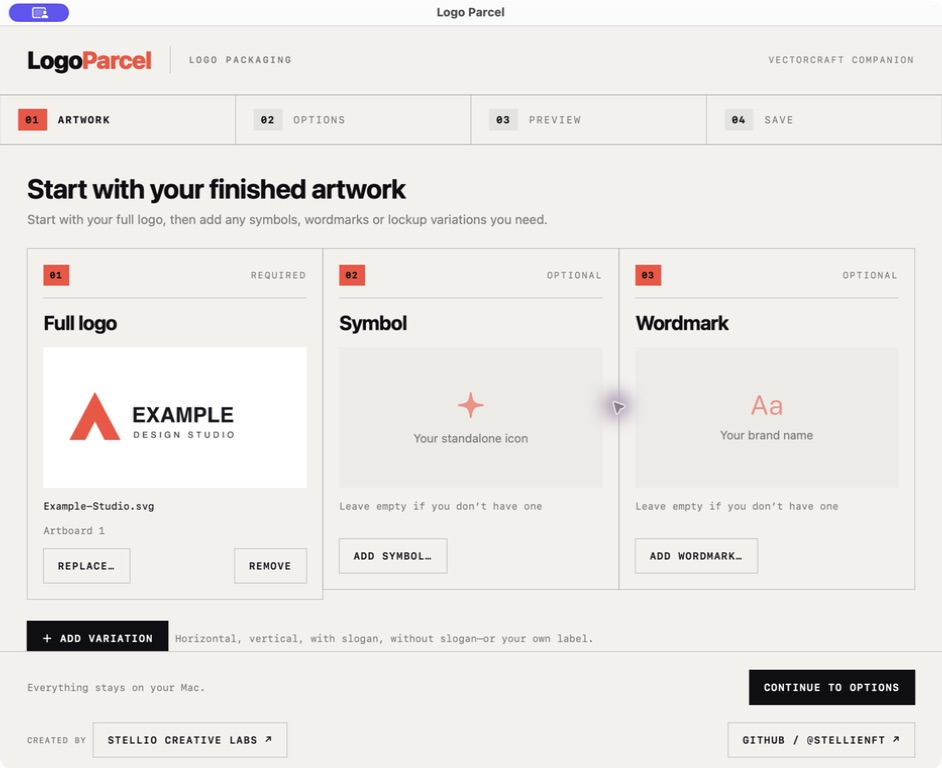
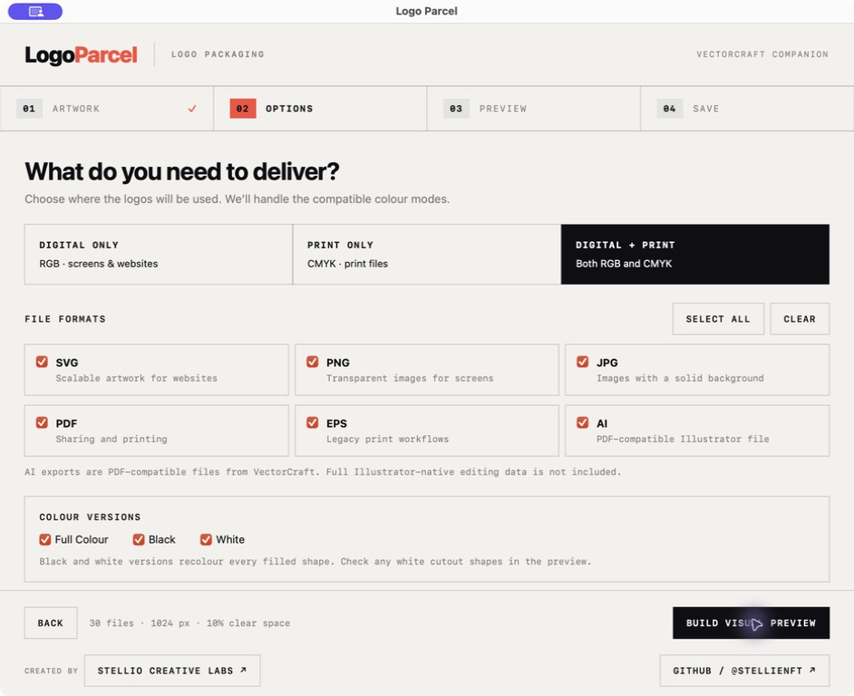
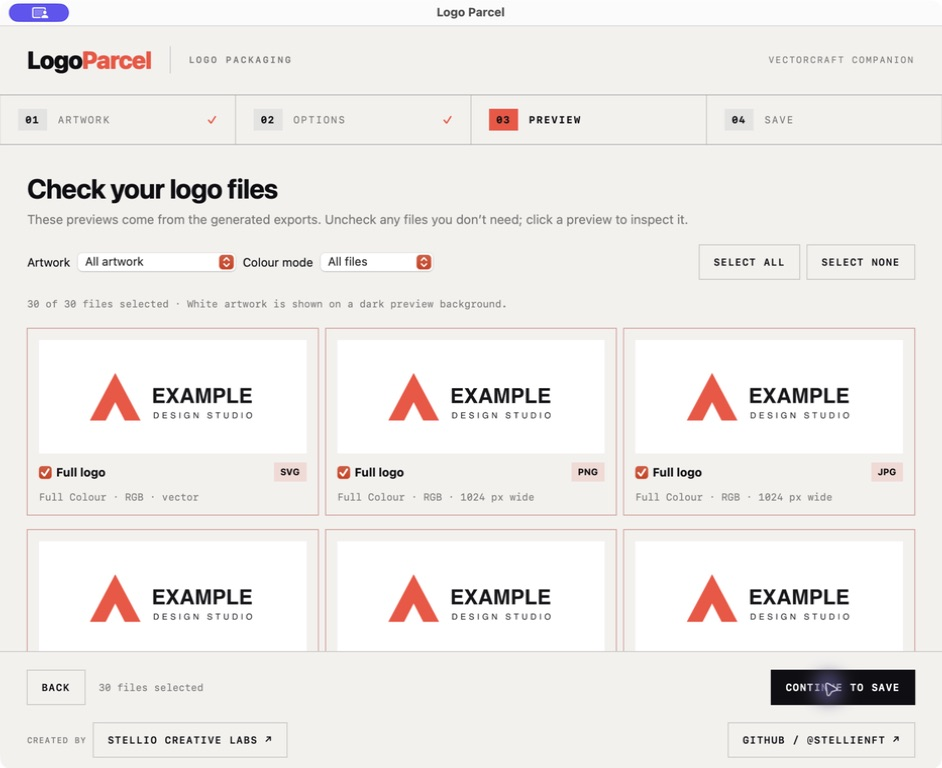
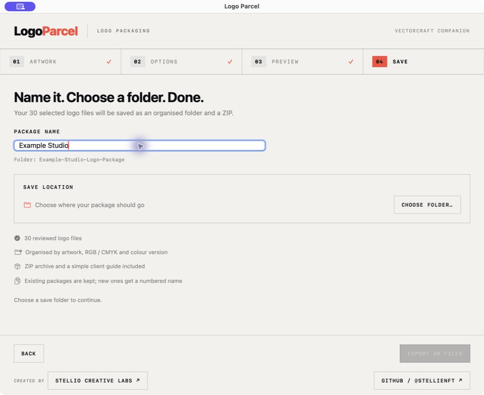

# Logo Parcel


**A straightforward logo handoff tool for Mac.**

Created by [Stellio Creative Labs](https://stellio.com.au) · [GitHub / @stellienft](https://github.com/stellienft)

Logo Parcel takes your approved logo artwork and packages the versions your client needs: colour variations, RGB and CMYK files, organised folders, a ZIP archive and a visual HTML guide.

**Status: beta, version 0.6.0.** Apple silicon (M1 or later), macOS 13 or newer. Tested on macOS 26.6.2; older supported versions have not yet been tested on clean Macs. Intel Macs are not supported by this download.

## Download for Mac

[**Download Logo Parcel 0.6.0 beta for Apple silicon**](https://github.com/stellienft/logo-parcel/releases/download/v0.6.0-beta.1/Logo-Parcel-0.6.0-macOS-arm64.zip)

1. Download and unzip the archive.
2. Drag **Logo Parcel.app** into **Applications**.
3. Open Logo Parcel. The export engine and Python runtime are included; no developer tools are needed.

This community beta is ad-hoc signed, not Apple Developer ID signed or notarised. macOS may block the first launch. If you trust this download, follow [Apple's instructions](https://support.apple.com/en-au/102445) to approve it in **System Settings → Privacy & Security → Open Anyway**. Some managed Macs may not permit this. Do not disable Gatekeeper globally.

Release assets include a SHA-256 checksum. Source code downloads alone are not the installable app.

## Screenshots

A look at the four-step workflow in version 0.4.0, using fictional example artwork.

| Add your artwork | Choose export options |
| --- | --- |
|  |  |
| **Review the actual files** | **Name and save your package** |
|  |  |

[View the full-size screenshot gallery](screenshots/README.md).

## What it does

- Start with a full logo; optionally add a symbol and wordmark. Rename any artwork title, including these three defaults.
- Add named variations: horizontal, vertical, with slogan, without slogan, social avatars or your own label.
- Choose SVG, PNG, JPG, PDF, EPS and PDF-compatible AI exports.
- Choose digital (RGB), print (CMYK) or both.
- Generate full-colour, black, white, grayscale and custom solid versions; use supplied dark-background artwork instead of colour inversion.
- Add approved black, white and dark-background artwork per item to preserve symbol details and cutouts.
- Check missing fonts, linked images, bitmap resolution and risky monochrome recolouring before previewing.
- Save and reopen portable `.logoparcel` projects containing artwork snapshots, overrides, names, settings and file selections.
- Drop saved files onto artwork cards or the multi-file drop area.
- Choose automatic, white, dark, checkerboard or custom HEX preview backgrounds.
- Apply Client handover, Digital only or Print supplier presets; save and delete your own.
- Check GitHub Releases automatically at startup and daily, or use **Logo Parcel → Check for Updates…**.
- Add ready-made web and social sets: favicons (`favicon.ico`, 16 and 32 px, Apple touch icon, Android 192 and 512 px), a profile avatar, LinkedIn, X, Facebook and YouTube covers, and an email signature image.
- Choose the printer's CMYK profile (an installed ICC profile or any `.icc` file) instead of the generic profile.
- Get plain-language checks before you deliver: live text, small or linked images, very light artwork, and wide artwork used for favicons.
- Review visual previews and select the exact files to deliver.
- Set your own filename pattern, such as `{brand}_{item}_{colour}_{mode}_{size}`.
- Save an organised folder and ZIP, with a branded, offline HTML logo library.
- Give clients their brand colours (HEX, RGB, CMYK and optional Pantone references) with ASE, CSS and JSON swatch files.
- Include usage guidelines (clear space, minimum sizes, and visual do's and don'ts) and a one-page PDF brand sheet.
- Reopen saved projects from the Recent projects menu.
- Keep original artwork unchanged. All artwork processing takes place locally.
- See the repository’s GitHub star count in the header, and an **Update** badge when a newer release is published. Both update when the app window opens. An unavailable count displays a dash.

## How to use it

### 1. Save your finished artwork

Save your logo from VectorCraft first. SVG or `.vectorcraft` are good starting points; PDF, EPS and AI files can also be opened. Prepare the symbol, wordmark and other lockups as separate files or artboards. Logo Parcel packages approved designs; it does not invent lockups or automatically separate the parts of a logo.

### 2. Add your artwork

Click **Add full logo**, or drop a saved supported file onto its card. Drop several files on the drop area to add variations. Direct dragging from the VectorCraft canvas is not supported.  Add a symbol or wordmark if needed. Use the **pencil icon** beside any card title to change its title; the new title is used in previews, folders and filenames. The first card remains required regardless of its title. Click **Add variation** for additional items and give each one a descriptive name, such as “Vertical lockup — no slogan”. For files with several artboards, select the relevant artwork from the thumbnails.

Expand **Approved colour versions** under an imported item to add black, white and dark-background files. These are exported as supplied, with normal colour-mode conversion and padding. Without an override, black and white are generated by merging colours; this can hide interior shapes. A dark-background version always requires supplied artwork for every included item.

Use **Save project…** (⌘S) to save an editable `.logoparcel` project and **Open project…** (⌘O) to restore it. Artwork is copied into the project, with linked content embedded where possible. Fonts are not bundled; install required fonts or outline lettering before sharing a project. Rebuild the preview after reopening; saved file selections are reapplied to matching exports. Custom presets are stored on your Mac and do not include artwork.

### 3. Choose your exports

Apply a preset, or choose **Digital only**, **Print only** or **Both**. Every setting remains editable. Select file formats, colour versions and optional web/social sets. Open **More options** for raster widths, clear space, print profiles and other settings. Incompatible format/mode combinations are excluded automatically.

### 4. Review the actual files

Click **Check artwork & preview**. Resolve blocking errors such as missing fonts or links, and acknowledge any warnings before building the preview. Checks are advisory, not print certification.  Enlarge a preview to inspect it, filter the grid and uncheck files you do not want. Use the **Preview background** menu to inspect transparency and contrast. Background changes only affect the preview; they do not alter exports. Automatic mode shows white and dark-background artwork against a dark tile.
### 5. Name and save

Choose a package name and save folder, then click **Export**. Existing packages are kept with numbered filenames. The files delivered are the exact bytes reviewed in the preview.

- **File names**: edit the pattern using `{brand}`, `{item}`, `{colour}`, `{mode}`, `{size}` and `{format}`. An example updates as you type. Favicons keep their standard web names.
- **Client guide**: choose whether to include brand colours (add Pantone references if you have them), usage guidelines with minimum sizes and your own notes, and the PDF brand sheet.

### 6. Hand the package to your client

Send the ZIP. After extracting it, the client opens **START-HERE.html** to browse the logo library. It contains previews, format links, digital/print filters, a variation search box, detected HEX/RGB colours, export clear-space information and guidance for websites, social graphics and print. Detected colours are not Pantone or approved print specifications; export padding is not a substitute for brand guidelines. Keep that HTML file beside the artwork folders so its links work. It needs no account or internet connection; the creator links are external.

## Privacy

Artwork stays on your Mac. The header requests the public GitHub star count. The update checker requests public release metadata at launch and then daily while running. Neither sends artwork or package names. Automatic checks and beta-release checks can be switched off in **Check for Updates…**. Updates open GitHub for manual download; the app does not install updates itself. Earlier versions must be updated manually once to receive the checker. Exporting does not need an internet connection.
## File support and limits

| Format | Digital RGB | Print CMYK | Notes |
| --- | --- | --- | --- |
| SVG | Yes | No | Scalable web artwork; optional text outlining |
| PNG | Yes | No | Transparent backgrounds |
| JPG | Yes | Yes | White and dark-background variants use a black background |
| PDF | Yes | Yes | VectorCraft export; check printer requirements |
| EPS | Yes | Yes | May flatten effects/transparency |
| AI | Yes | Yes | PDF-compatible output, not Adobe's full native editing data |

CMYK conversion uses VectorCraft's generic SWOP-like profile unless you choose a print profile. A chosen profile is loaded only for the export, without changing VectorCraft’s saved settings. Projects include a copy of the selected profile. Brand colour CMYK values use the same profile; Pantone references are entered by you, not calculated. Printed appearance depends on the output profile, paper and printer. Automatic monochrome recolouring also recolours white filled shapes; use real cutout paths or approved monochrome artwork where needed. Check font substitutions, images and complex effects in the previews and export notes.

The current version has no live connection to an unsaved editor document and does not calculate Pantone matches. Web and social sets use full-colour RGB artwork on white or transparent backgrounds. These canvas sizes are starting templates; check cropping on the destination platform.

## Build locally (development)

Requirements: an Apple silicon Mac, Apple Command Line Tools with Swift, the official VectorCraft 0.13.1 macOS CLI package, and the standalone Python runtime pinned in `resources/runtime.json`.

1. Download and extract the official [VectorCraft CLI release](https://github.com/storytold/vectorcraft/releases/tag/v0.13.1), including its licence and notice files.
2. Download the Python install-only archive specified in `resources/runtime.json` and verify its SHA-256 checksum. Extract it to obtain the `python` folder.
3. Obtain the matching full Python distribution from [Python Build Standalone release 20261013](https://github.com/astral-sh/python-build-standalone/releases/tag/20261013) and copy its `python/licenses` directory into the extracted runtime's `python/licenses`. The matching full archive is `cpython-3.13.16+20261013-aarch64-apple-darwin-pgo+lto-full.tar.zst`, SHA-256 `3497822d8bf4884bc79258f62668f985654d03d40ec74da4ca9ae7a5667c4362`.
4. Build with both extracted directories:

```sh
bash scripts/build-local.sh /path/to/vectorcraft-cli-package /path/to/python
```

The app is written to `dist/Logo Parcel.app`. It contains the runtime, engine, icon and licence notices. The build is ad-hoc signed for beta testing and is not notarised. It targets Apple silicon and macOS 13 or newer.

## Regression checks

Run the Python tests with the bundled engine:

```sh
LOGO_PARCEL_ENGINE="/path/to/vectorcraft-cli" python3 tests/test_workflows.py
```

The tests cover approved cutouts across all six formats in RGB/CMYK, preview-to-delivery integrity, missing fonts, bitmap resolution, portable projects and invalid project paths. `tests/ModelTests.swift` covers version comparisons, presets and artwork renaming; compile it together with the app declarations with the `@main LogoParcel` entry point removed.

## Project structure

- `src/LogoParcel.swift` — native SwiftUI interface and guided workflow.
- `src/packager.py` — VectorCraft export orchestration, preview verification and packaging.
- `src/htmlguide.py` — self-contained client HTML guide.
- `src/brandfiles.py` — swatch (ASE/CSS), favicon (ICO), PDF brand sheet and ICC profile helpers, using the Python standard library only.
- `tests/` — engine tests run against a fake `vectorcraft-cli`: `python3 -m unittest discover tests`.
- `resources/branding.json` — creator website link.
- `scripts/build-local.sh` — local development build.
- `RELEASE_CHECKLIST.md` — remaining public-distribution steps.

Do not commit the generated app, engine binary, test output, customer logos, certificates or credentials. Use GitHub release assets for distributable application packages.

## Credits and licensing

Original app and guide by Stellio Creative Labs. Export rendering uses [VectorCraft](https://github.com/storytold/vectorcraft), with its supplied MIT/Apache and third-party notices preserved in distributed engine packages. Logo Parcel is independent of ArtCraft. The bundled Python runtime is supplied by [Python Build Standalone](https://github.com/astral-sh/python-build-standalone); Python and dependency licence notices are retained in the app.

Logo Parcel's original source is available under the [MIT License](LICENSE), copyright © 2026 Stellio Creative Labs. VectorCraft and other dependencies retain their own licences and notices.

## Feedback

Use [GitHub Issues](https://github.com/stellienft/logo-parcel/issues) to report a problem. Include your app version, macOS version, source format and export settings. Only attach artwork you are permitted to share.
